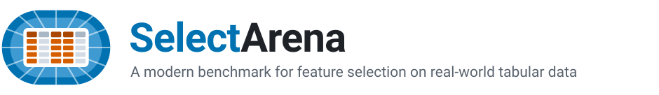

<p align="center">
  <picture>
    <source media="(prefers-color-scheme: dark)" srcset="docs/assets/banner-dark.svg">
    
  </picture>
</p>

<p align="center">
  <a href="https://arxiv.org/abs/2610.13644"></a>
  <a href="https://huggingface.co/spaces/SelectArena/Leaderboard"></a>
  <a href="https://huggingface.co/datasets/SelectArena/SelectArena_Datasets"></a>
  <a href="https://github.com/autogluon/tabarena"></a>
  
  <a href="LICENSE"></a>
</p>

<p align="center">
  <a href="https://arxiv.org/abs/2610.13644"><b>Paper</b></a> ·
  <a href="https://huggingface.co/spaces/SelectArena/Leaderboard"><b>Leaderboard</b></a> ·
  <a href="https://huggingface.co/datasets/SelectArena/SelectArena_Datasets"><b>Datasets</b></a> ·
  <a href="#add-your-method-to-selectarena"><b>Add your method</b></a>
</p>

SelectArena is a **living benchmark** for feature selection on real-world tabular IID data. Each feature selection
method selects a budgeted number of features, and the selection is judged by the downstream performance of tabular
models trained on the selected features, plus a stability and validity benchmark that captures the interpretability
of the methods. The [leaderboard](https://huggingface.co/spaces/SelectArena/Leaderboard) is updated as new methods
are added.

## Installation

SelectArena depends on [TabArena](https://github.com/autogluon/tabarena).
```bash
uv venv --python 3.12 .venv && source .venv/bin/activate
uv pip install --prerelease=allow -e ".[models,dev]"
```

With pip, use `pip install --pre -e ".[models,dev]"`. The `models` extra adds the downstream
models of the default benchmark config (TabICLv2, RealMLP).

## Quickstart

```bash
python examples/quickstart.py   # every selector inside an AutoGluon TabularPredictor (OpenML dataset 55)
python examples/run_local.py    # a small benchmark through TabArena's runner on a toy task
```

`run_local.py` prints one row per run with the downstream error, the number of selected features
and the selection time.

## Running the benchmark on a SLURM cluster

1. Describe your machine: `cp configs/cluster.example.yaml configs/cluster.yaml` and set the
   workspace, the Python of your environment, the cache directories and the SLURM partitions.
   `configs/cluster.yaml` is git-ignored.
2. Optional: download the dataset suite and convert it into TabArena tasks in advance with
   `python scripts/prepare_datasets.py`; otherwise `setup` does it (see [Datasets](#datasets)).
3. Choose what to run in `configs/benchmark.yaml` (methods, budgets, time limits, models, splits).
4. On the head node: `python scripts/run_benchmark.py setup`, then launch the printed `sbatch`
   command(s). Rerunning `setup` skips jobs whose results exist.
5. When the jobs are done: `python scripts/run_benchmark.py eval` writes
   `<workspace>/output/<benchmark_name>/results.csv`, one row per result including the selected
   features, their scores and the selection time.

The stability and validity benchmark uses the same configs:

```bash
python scripts/run_extra_benchmark.py setup     # writes SLURM array scripts (add --submit to submit)
python scripts/run_extra_benchmark.py collect   # stability_results.csv, validity_results.csv
```

Both config files can be passed explicitly with `--config` and `--cluster-config`; the cluster
config is also read from `$SELECTARENA_CLUSTER_CONFIG`.

## Running the benchmark on an OAR cluster

With `scheduler: oar` in the cluster config, the same scripts write OAR parametric array jobs
and print `oarsub` commands instead of `sbatch` ones (`--submit` submits them). The jobs, their
bundling and the results are the same as on SLURM. Start from `configs/cluster.oar.example.yaml`.

## Add your method to SelectArena

To add a method, ask Claude Code to "add <method>" in this repo: the `add-method` skill
(`.claude/skills/add-method/`) writes the `AbstractFeatureSelector` subclass from templates,
registers it and verifies it. `python scripts/check_method.py <ClassName>` (or `--all`) checks any
method against the benchmark's contract: registration, output format on binary / multiclass /
regression data, determinism and the selection time limit.

Search methods (forward, backward, leave-one-out) evaluate many feature subsets; non-search methods
use a proxy instead (Appendix A of the paper). Methods with a proxy model fit a LightGBM model
(configurable through `ProxyModelConfig`) inside the selection.


## Leaderboard

The [public leaderboard](https://huggingface.co/spaces/SelectArena/Leaderboard) holds the site and this repo generates the data it serves:

```bash
python scripts/run_benchmark.py eval                # results.csv
python scripts/run_extra_benchmark.py collect       # optional: stability / validity
python scripts/run_generate_website_artifacts.py    # generated_website_artifacts/
```

Put the result files in `results/` and pass them explicitly; no cluster config is needed then:

```bash
python scripts/run_generate_website_artifacts.py \
    --results results/performance_results.csv --extra-dir results   # stability_results.csv, validity_results.csv
```

`generated_website_artifacts/clean_website_artifacts/website_data/` replaces the Space's `data/`
folder.
`raw_website_artifacts/` keeps the main figure as PNG/PDF for the paper. The generator lives in
`selectarena/website/`; the Elo computation (`selectarena/evaluation/elo.py`), the Pareto front
(`pareto.py`) and the lasagna plots (`lasagna.py`) are in `selectarena/evaluation/`. All figures on
the website are interactive SVG pages (`website/html.py`, `website/figures.py`) that follow its
light or dark theme; their SVG / PNG downloads always use the light paper look.

**Publishing** is done by the `update-leaderboard` skill (`.claude/skills/update-leaderboard/`):
ask Claude Code to "update the leaderboard" in this repo with the path of a clone of the Space
(`git clone https://huggingface.co/spaces/SelectArena/Leaderboard`). It checks that every method
has a subgroup of the paper's taxonomy, regenerates the artifacts, swaps them into the Space's
`data/`, bumps the site's version, runs the Space's smoke test and a local preview, and leaves
the commit and `git push` (which deploys) to you. The manual steps are in the docstring of 
`scripts/run_generate_website_artifacts.py`.


## Repository layout

```
src/selectarena/
  methods/          feature selectors, their base class and the registry
  benchmark/        FSBench pipelines and the TabArena subclasses
  extra_benchmark/  stability / validity benchmark (selection only)
  evaluation/       reading results.pkl files into a table, leaderboard tables, Elo
  website/          the leaderboard Space's data (subsets, tables, interactive figure)
  datasets.py       the dataset suite (Data Foundry containers)
  config.py         YAML configs and the tabflow_slurm plan built from them
configs/            benchmark.yaml, cluster.example.yaml (SLURM), cluster.oar.example.yaml (OAR)
scripts/            prepare_datasets.py, run_benchmark.py, run_extra_benchmark.py,
                    run_generate_website_artifacts.py, check_method.py
.claude/skills/     add-method: add a feature selection method;
                    update-leaderboard: regenerate and publish the leaderboard
examples/           quickstart.py, run_local.py
tests/
```

## Tests

```bash
pytest
```

`tests/test_benchmark_integration.py` runs real (small) fits through TabArena's experiment runner.
